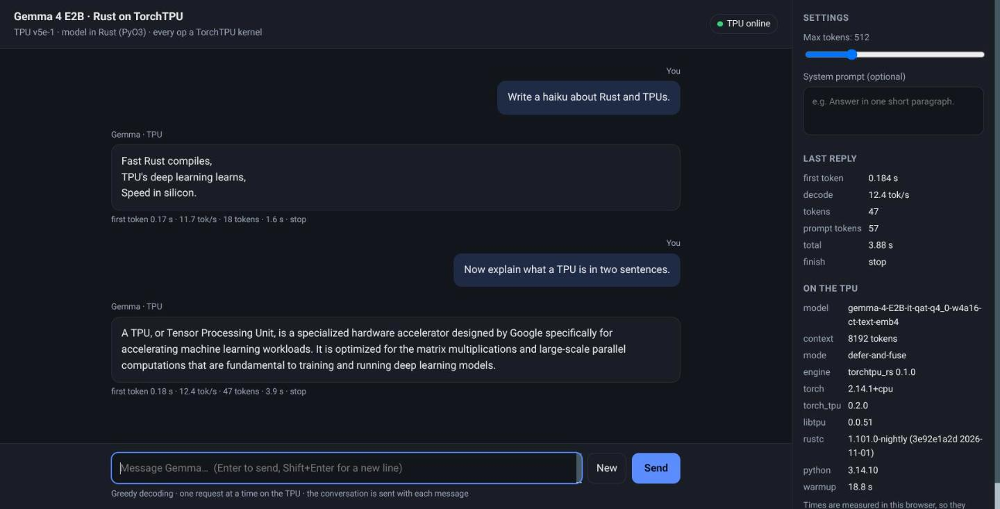

This article provides a step by step guide to serving Gemma 4 E2B from a Cloud TPU v5e-1 VM with the model written in Rust and every operation run by TorchTPU. A Claude Code MCP server provisions the TPU, the VM builds the Rust crate on boot and serves an OpenAI-compatible endpoint, and a local shim gives it a chat page and a second MCP server for demos. Python hosts the process and the HTTP server; the 35 layers, the ring cache and the decode loop are Rust.

https://github.com/xbill9/torchtpu-dev/tree/main/tpu-pytorchrust-v5e1-2b-q4w4a16emb4

**The Rust model reaches TorchTPU through a 154-line C++ shim over ATen, so it builds against whichever PyTorch is installed: here Python 3.14, PyTorch 2.14.1 and a nightly Rust.** It matches Hugging Face Transformers on 64 of 64 greedy tokens on CPU, boots on a fresh TPU VM in 4 minutes 29 seconds from installing Python to starting the service, and decodes at a median 12.20 tokens per second on the TPU.



---

#### What Is Being Built?

[Gemma 4 in Rust on TorchTPU: Hands On With Colab](https://dev.to/gde/gemma-4-in-rust-on-torchtpu-hands-on-with-colab-44hi) ran the same Rust engine in a Colab notebook. This rig takes it to a TPU VM of its own and keeps it there:

| Layer | Where | What |
| :--- | :--- | :--- |
| Capacity | Claude Code | An MCP server that creates a v5e-1 queued resource and reads its boot stages |
| Model | TPU VM | `torchtpu_rs`, a Rust crate built on the VM as a PyO3 extension |
| Kernels | TPU VM | ATen calls through PyTorch's dispatcher to TorchTPU |
| API | TPU VM, port 8000 | `rust_openai_server.py`, OpenAI-compatible, streaming |
| Demo | This laptop | A shim on `127.0.0.1:8015` with a chat page, and a demo MCP server |

The checkpoint is the W4A16 repack `xbill9/gemma-4-E2B-it-qat-q4_0-w4a16-ct-text` with the int4 vocabulary tables from its `-text-emb4` twin. The directory name follows the rig naming scheme: `tpu` (Cloud TPU API), `pytorchrust` (the forward pass is Rust over PyTorch's ATen), `v5e1`, `2b`, and `q4w4a16emb4` for the encoding.

Versions on the VM, read from its `/v1/engine`: Python 3.14.10, PyTorch 2.14.1, `torch_tpu` 0.2.0, `libtpu` 0.0.51, Transformers 5.20.2, `rustc` 1.101.0-nightly.

---

#### Step 1 — Install the Rig

The rig is a Claude Code plugin with its own MCP server and skill:

```shell
git clone https://github.com/xbill9/torchtpu-dev
cd torchtpu-dev/tpu-pytorchrust-v5e1-2b-q4w4a16emb4
./project-setup.sh . --project <gcp-project-id>
```

Every setting lives in `tpu.env`: the zone, the two checkpoints, the Python and PyTorch versions the VM installs, the cache length and the firewall tags. PyTorch and TorchTPU come from public PyPI:

```text
PYTHON_BIN=python3.14
TORCH_PIP_SPEC=torch==2.14.1 torch_tpu==0.2.0 transformers==5.20.2 compressed-tensors==0.19.0 'jinja2>=3.1' huggingface_hub fastapi uvicorn
SERVE_CONTEXT=8192
SERVE_DEFER_AND_FUSE=1
```

Python 3.14 is the newest version `torch_tpu` 0.2.0 ships wheels for. The Rust toolchain is named in the crate's `rust-toolchain.toml`, `channel = "nightly"`, and the crate is on edition 2024.

---

#### Step 2 — Reach TorchTPU Without `tch`

TorchTPU registers its kernels on libtorch's dispatcher and ships no C++ API of its own, so Rust reaches it through ATen. The `tch` crate wraps every ATen operation in generated C++ that compiles against PyTorch 2.13.0 only. The model uses a few dozen operations, so the crate wraps those itself, in `rust/src/aten.cpp`:

```cpp
#define RET(expr) TRY(return box(expr);) return nullptr;

extern "C" {
Tensor* aten_matmul(Tensor* a, Tensor* b) { RET(at::matmul(*a, *b)) }
Tensor* aten_linear(Tensor* x, Tensor* w) { RET(at::linear(*x, *w)) }
Tensor* aten_softmax(Tensor* a, int64_t d, int k) { RET(at::softmax(*a, d, kind(k))) }
Tensor* aten_index_copy_(Tensor* t, int64_t d, Tensor* idx, Tensor* src) { RET(t->index_copy_(d, *idx, *src)) }
// torch.Tensor <-> at::Tensor, through libtorch_python. Both directions share storage.
Tensor* aten_from_python(PyObject* o) { RET(THPVariable_Unpack(o)) }
PyObject* aten_to_python(Tensor* t) { TRY(return THPVariable_Wrap(*t);) return nullptr; }
}
```

`rust/src/aten.rs` gives them `tch`'s method names, so the model code reads as before. `build.rs` asks the installed `torch` for its headers, libraries, C++ ABI and version, and compiles the shim against them with C++20, which PyTorch 2.14's headers require. The module records what built it:

```text
>>> torchtpu_rs.BUILD
{'torch': '2.14.1+cpu', 'rustc': 'rustc 1.101.0-nightly (3e92e1a2d 2026-11-01)', 'python': '3.14.7', 'crate': '0.1.0'}
```

A module built for one PyTorch refuses to load under another, because the C++ ABI differs: `import torchtpu_rs` compares `torch.__version__` with the version it was built against and raises ImportError on a mismatch.

---

#### Step 3 — The PyO3 Bindings

Every PyO3 item is in `rust/src/bindings.rs`; the model and weight code never see a Python object. `rust/PYO3.md` lists each crossing, and `rust/python/torchtpu_rs.pyi` is the type stub. Four rules shape the code.

**Token ids are lists, tensors share storage.** `decode(ids: list[int], ...)` returns `list[int]`; generated tokens never cross as tensors. The one tensor that crosses on every load is `like`, a `torch.zeros(1, device="tpu")` that names the device: Rust builds each weight on the host and moves it with `type_as(like)`.

**Long calls release the GIL; the callback takes it back.** The server streams through a callback that runs once per token batch:

```rust
let done = py.detach(|| {
    aten::no_grad(|| {
        gemma.decode(&ids, max_new, &stop, read_every, |batch| {
            let Some(cb) = &on_tokens else { return true };
            Python::attach(|py| {
                let call = PyList::new(py, batch).and_then(|l| cb.call1(py, (l,)));
                match call.and_then(|r| r.is_truthy(py)) {
                    Ok(go_on) => go_on,
                    Err(e) => { failed = Some(e); false }
                }
            })
        })
    })
});
```

A false return ends the decode with `finish="cancelled"`, and an exception in the callback is raised from `decode`. Generation stops at the checkpoint's `eos_token_id` list, `[1, 106, 50]`.

**The engine is `#[pyclass(unsendable)]`.** It owns TPU tensors and one ring cache, so PyO3 checks the calling thread on every access. A call from another thread raises `pyo3_runtime.PanicException`, which derives from BaseException. The server builds the engine on one dedicated thread and queues every request to it:

```python
class EngineWorker(threading.Thread):
    """Owns the one `torchtpu_rs.Engine`. Nothing outside this thread may touch it."""
```

**Errors a caller can cause are ValueError.** An empty prompt, `max_new` below 1, or a prompt longer than the cache are checked in `bindings.rs` before the model's own asserts.

`tests/test_rust_bindings.py` runs all of these on CPU against the real checkpoint:

```text
test_bad_input_is_value_error ... ok
test_callback_exception_propagates ... ok
test_cancel_and_length ... ok
test_decode_stops_and_streams ... ok
test_gil_released_during_decode ... ok
test_module_surface ... ok
test_tensor_functions ... ok
test_unsendable ... ok
Ran 8 tests in 247.568s
OK
```

---

#### Step 4 — Check It Against Transformers

Before any TPU time, the Rust module and Hugging Face Transformers 5.20.2 run the same prompt on CPU, both on PyTorch 2.14.1, one process per side:

```text
top5 rust [818, 8409, 102500, 4420, 16520] hf [818, 102500, 8409, 4420, 16520]
KL(hf||rs) 1.078e-05; same 64 of 64; first diff None
```

The five top candidates are the same set, the KL divergence of the first token's distribution is 1.1e-5, and all 64 greedy tokens match.

---

#### Step 5 — Provision the TPU

From Claude Code, the rig's MCP server creates a flex-start v5e-1 queued resource in `us-west4-a`. The startup script travels in the instance metadata with the crate and the server packed inside it, 47 KiB rendered, so the VM needs no SSH to get its code:

```text
> create_tpu_queued_resource
🚀 Queued Resource gemma4-rust-qr creation initiated in us-west4-a, serving `xbill9/gemma-4-E2B-it-qat-q4_0-w4a16-ct-text-emb4`.
```

A TPU VM has no serial-console command, so the startup script writes each stage to a guest attribute and `get_rig_progress` reads it back without SSH. The boot on 2026-11-02:

```text
STAGE: python
g++ (Ubuntu 11.4.0-1ubuntu1~22.04) 11.4.0
STAGE: torch
torch 2.14.1+cpu
STAGE: rust
STAGE: crate
rustc 1.101.0-nightly (3e92e1a2d 2026-11-01)
    Finished `release` profile [optimized] target(s) in 21.03s
STAGE: weights
STAGE: smoke
torchtpu_rs 0.1.0 matmul_sum 512.0 on tpu:0
TPU smoke OK
STAGE: unit
STAGE: serving
```

From installing Python to starting the service took 4 minutes 29 seconds. The smoke test is a Rust call on a tensor on the TPU, through the shim, checked for the right value and a result on `tpu:0`. The service then loads the weights in 6.8 seconds and runs a warmup decode in 18.8 seconds before `/health` answers.

---

#### 🔎 Tip: Pin `jinja2>=3.1` on a TPU VM

The TPU image's own `jinja2` 3.0.3 sits in `/usr/lib/python3/dist-packages`, which is on the path of the deadsnakes Python. Transformers' chat templates need 3.1 or later and refuse to render with the older one:

```text
ImportError: apply_chat_template requires jinja2>=3.1.0 to be installed. Your version is 3.0.3.
```

`'jinja2>=3.1'` in the pip spec puts a newer copy in `/usr/local/lib/python3.14/dist-packages`, which comes first on the path.

---

#### Step 6 — The OpenAI Endpoint

The VM serves `/v1/chat/completions` and `/v1/completions`, streamed or not, plus `/v1/models`, `/health` and `/metrics`. `/v1/engine` reports what is loaded and how it is bound:

```json
"torch_tpu_defer_and_fuse": "1",
"load_seconds": 6.83,
"warmup_seconds": 18.8,
"layout": {"full_rings": 3, "sliding_rings": 12, "shared_layers": 20, "context": 8192},
"engine_class": "Engine — #[pyclass(unsendable)], owned by thread torchtpu-rs-engine"
```

Decoding is greedy. Each non-streamed response carries the engine's own seconds for reading the prompt and for decoding, and `system_fingerprint` reads `torchtpu_rs-greedy`.

---

#### Step 7 — Measure It

The same prompt and length as a vLLM run on the same chip type, `Write a short paragraph about the ocean.` at 100 tokens, five requests one at a time, rate from the engine's own timer:

```text
request 1: 83 tokens, finish stop, read 0.088 s, decode 6.651 s, 12.33 tok/s, client 6.83 s
request 2: 83 tokens, finish stop, read 0.086 s, decode 6.720 s, 12.20 tok/s, client 6.89 s
request 3: 83 tokens, finish stop, read 0.086 s, decode 6.734 s, 12.18 tok/s, client 6.91 s
request 4: 83 tokens, finish stop, read 0.087 s, decode 6.762 s, 12.13 tok/s, client 6.94 s
request 5: 83 tokens, finish stop, read 0.083 s, decode 6.561 s, 12.50 tok/s, client 6.74 s
median decode tok/s 12.20, min 12.13, max 12.50
```

Streaming eight prompts through the shim from a laptop, `run_rust_benchmark` measured a first token in 0.175 to 0.256 seconds and 11.5 to 12.6 tokens per second as the client saw them.

---

#### Step 8 — Demo It From a Laptop

`demo/install.sh` installs two things on the laptop: a shim on `127.0.0.1:8015` as a systemd user service, and a demo MCP server registered with Claude Code:

```shell
demo/install.sh --project <gcp-project-id>
```

```text
> endpoint_status
🟢 local http://127.0.0.1:8015/v1 → http://136.85.219.123:8000
- TPU /health: 200
- queued resource `gemma4-rust-qr` in us-west4-a, project aisprint-491218
```

The shim finds the VM's address with `gcloud` and looks it up again when the VM stops answering, so a new flex-start VM needs no reconfiguration. It passes every request through, streams included, so any OpenAI client works against `http://127.0.0.1:8015/v1`. Its root is a chat page: replies stream, the conversation carries over, and Stop cancels the decode on the TPU. A client that disconnected after 10 streamed chunks moved the server's cancel counter from 1 to 2, and the engine went idle.

The demo MCP server, `torchtpu-rs-demo`, has five tools, all through the shim:

```text
> ask_gemma_rust "What is a TPU? Two sentences."
A TPU stands for **Tensor Processing Unit**, which is a specialized type of integrated circuit designed to accelerate machine learning workloads. ...
---
xbill9/gemma-4-E2B-it-qat-q4_0-w4a16-ct-text-emb4 · finish `stop` · 17 prompt + 55 completion tokens · prompt read 0.088 s · decode 12.2 tok/s on the TPU · 4.59 s round trip from here
```

`stream_gemma_rust`, `engine_info`, `endpoint_status` and `serving_metrics` cover streaming, the build, the shim's view of the VM and the server's counters.

---

#### Compare and Contrast

One TPU v5e chip, Gemma 4 E2B, decode tokens per second for one request at a time. Cost per million output tokens is computed from each rate and the v5e-1 flex-start list price, USD 0.60 an hour (arithmetic, `evidence/arithmetic.txt`):

| One v5e chip | Decode tok/s | Model code | Stack | USD per M tokens |
| :--- | ---: | :--- | :--- | ---: |
| vLLM 0.30.0 🥇 | 144.1 | Python | vLLM TPU, bf16 checkpoint | 1.16 |
| Python `torch.compile`, Colab 🥈 | 33.5 streamed, 45.1 batched | Python | TorchTPU, PyTorch 2.14.1 | |
| Rust, `tch`, Colab 🥉 | 15.1 streamed | Rust | TorchTPU defer-and-fuse, PyTorch 2.13.0 | |
| Rust, ATen shim, this rig | 12.20 | Rust | TorchTPU defer-and-fuse, PyTorch 2.14.1 | 13.66 |

The vLLM figure is from [the gcp-inference demo](https://github.com/xbill9/gcp-inference) on 2026-10-12, read from vLLM's own metrics. vLLM decodes 11.8x faster than this rig on the same chip type. The compiled Python step decodes 2.75x faster when streaming.

`torch.compile` traces Python and cannot see a Rust model, so the Rust ways run TorchTPU's defer-and-fuse mode, which fuses operations below ATen. This rig streams at 0.81x the Colab `tch` run. The two differ in PyTorch version, ATen layer, cache length (8,192 tokens against 33,024), a Python callback per streamed token, and where the timer sits; which of those accounts for the gap is not measured.

---

#### So, Which One?

For throughput on a v5e, serve with vLLM: 144.1 tokens per second on one request and USD 1.16 per million tokens.

For a model written in Rust on TorchTPU, this rig is the working shape: a crate that builds against the installed PyTorch, PyO3 bindings that keep the event loop free while the TPU works, and an OpenAI endpoint any client can use. It decodes at about 12 tokens per second.

For a demo, the shim gives one local address for a browser, an OpenAI client and Claude Code, whichever VM is up.

---

#### Summary

The goal of this article was to serve Gemma 4 E2B from a TPU VM with the model in Rust, through TorchTPU and without JAX, and to operate it from Claude Code. The key to the solution was a C++ shim over the few dozen ATen operations the model uses, compiled against the installed PyTorch, with PyO3 bindings that release the GIL during decoding and confine the engine to one thread. The results on one TPU v5e chip were:

- 🟢 Rust matches Transformers on CPU on 64 of 64 tokens, with a KL divergence of 1.1e-5, on PyTorch 2.14.1
- 🟢 No pinned PyTorch: Python 3.14, PyTorch 2.14.1 and nightly Rust on the VM
- 🟢 4 minutes 29 seconds from installing Python to starting the service, with the crate built on the VM in 21 seconds
- 🟢 OpenAI endpoint, streaming, cancel on disconnect, an MCP server for the TPU and one for demos, and a local chat page
- ⚠️ 12.20 tokens per second median decode, 11.8x slower than vLLM on the same chip type
- ⚠️ One request at a time and greedy decoding only; no tool-call parsing
- ❌ No compile path from Rust: `torch.compile` traces Python, and TorchTPU 0.2.0 has no C++ API

Scope: Gemma 4 E2B-it QAT W4A16 with int4 vocabulary tables, text only, one flex-start v5e-1 queued resource in `us-west4-a` on 2026-11-02, an 8,192-token cache, greedy decoding, one request at a time. The vLLM and `torch.compile` figures come from other runs on the same chip type (gcp-inference on 2026-10-12, Colab notebook 06 on 2026-11-01) with other checkpoints and cache lengths. Batched host reads, a longer cache and concurrent requests were not run on this rig. The parity check and the binding tests ran on a laptop CPU.

The strategy for serving a Rust model on TorchTPU was validated with an incremental step by step approach.

---

#### References

- The rig: https://github.com/xbill9/torchtpu-dev/tree/main/tpu-pytorchrust-v5e1-2b-q4w4a16emb4
- PyO3 bindings: https://github.com/xbill9/torchtpu-dev/blob/main/tpu-pytorchrust-v5e1-2b-q4w4a16emb4/rust/PYO3.md
- Demo shim, chat page and MCP server: https://github.com/xbill9/torchtpu-dev/tree/main/tpu-pytorchrust-v5e1-2b-q4w4a16emb4/demo
- Gemma 4 in Rust on TorchTPU, Hands On With Colab: https://dev.to/gde/gemma-4-in-rust-on-torchtpu-hands-on-with-colab-44hi
- gcp-inference: https://github.com/xbill9/gcp-inference
- PyO3: https://github.com/PyO3/pyo3
- W4A16 repack: https://huggingface.co/xbill9/gemma-4-E2B-it-qat-q4_0-w4a16-ct-text
- 4-bit-tables repack: https://huggingface.co/xbill9/gemma-4-E2B-it-qat-q4_0-w4a16-ct-text-emb4
